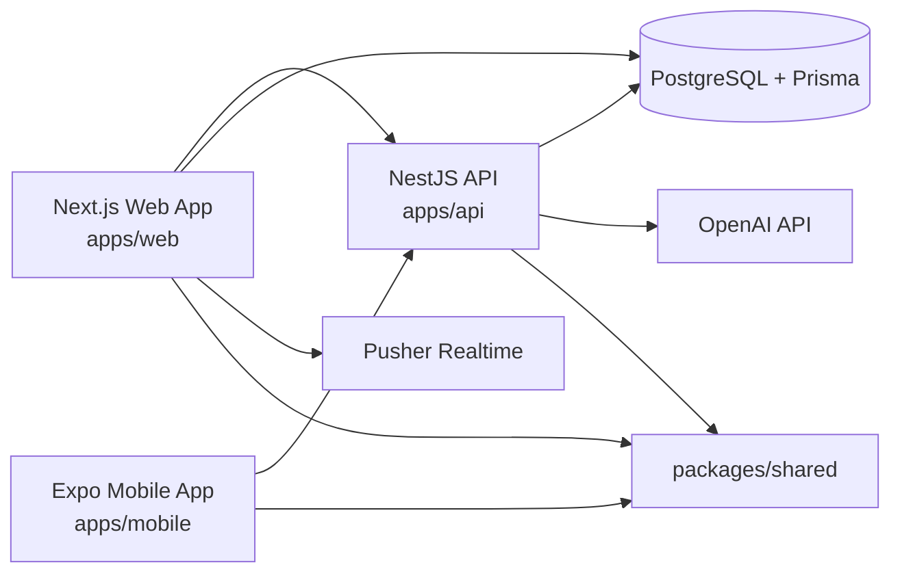

# UniSync

UniSync is a campus networking and collaboration platform for students, teachers, and independent learners.

Production: https://unisync.cc

Latest Vercel production deploys are created from `main` for the `unisync-web` project.

## What UniSync Does
- Connects users across universities and domains.
- Helps teams form faster and collaborate on projects.
- Surfaces opportunities such as hackathons, ideathons, and conferences.
- Provides AI-assisted workflows for planning and productivity.

## Landing Page Highlights
- Hero-led onboarding flow with search-first entry into the platform.
- India showcase section with the `MAKE IN INDIA` badge.
- University logo marquee row sourced from local logo files.
- Collaboration partners marquee row sourced from local company and government logo files.
- Current India showcase heading: `India's Student Innovation Network`.
- University logo assets live in `apps/web/public/Logos_uni`.
- Collaboration and company logo assets live in `apps/web/public/Company_logo`.

### Landing Asset Notes
- Only institutions or partners with real local logo files are rendered in the showcase rows.
- University row and collaboration row are configured in `apps/web/src/app/page.tsx`.
- Prefer transparent `png` or `svg` assets for cleaner rendering in the marquee.

## Architecture Overview



## Repository Structure

```text
unisync/
	apps/
		web/       Next.js web application
		api/       NestJS backend API
		mobile/    Expo React Native app
	packages/
		shared/    Shared DTOs, types, constants
		config/    Shared config package scaffold
	prisma/
		schema.prisma
	ARCHITECTURE.md
	DESIGN_SYSTEM.md
	ENGINEERING_AUDIT.md
```

## Core Modules
- Authentication and onboarding (JWT + Google OAuth).
- Discover, connections, and profile network graph.
- Teams, project collaboration, and chat workflows.
- Opportunities feed and leaderboard ranking.
- AI Lab and mentor tooling.

## Local Development

### Prerequisites
- Node.js 20+
- npm 10+
- Docker (optional but recommended for local infra)

### Start
```bash
npm install
npm run infra:up
npm run dev
```

Default local endpoints:
- Web: http://localhost:3000
- Mobile Metro: http://localhost:8081

If port `3000` is busy, run the web app on another port:

```bash
cd apps/web
npm run dev -- --port 3005
```

### Useful Commands
```bash
# Monorepo
npm run dev
npm run build
npm run test
npm run lint

# API
npm run dev --workspace @uniconnect/api
npm run build --workspace @uniconnect/api

# Web
npm run dev --workspace @uniconnect/web
npm run dev --workspace @uniconnect/web -- --port 3005
npm run build --workspace @uniconnect/web

# Database / Prisma
npm run db:generate
npm run db:push
npm run db:studio

# Infrastructure
npm run infra:up
npm run infra:down
```

## API and Data Notes
- Prisma schema is the source of truth in prisma/schema.prisma.
- Validation is handled at DTO boundaries.
- Auth uses JWT strategy and guards.
- API docs are available at /api/docs when API is running.

## Demo Accounts
- Teacher: teacher.demo@iitd.ac.in / demo123
- Student: student.demo@iitd.ac.in / demo123

**Note:** Demo accounts bypass the mandatory onboarding requirement for testing purposes.
In local development, when `NEXT_PUBLIC_DEMO_MODE=true`, opening the dashboard automatically signs in as the student demo account. This shortcut is disabled in production.

## Onboarding Pipeline

### User Access Flow
All new users (non-demo) are required to complete onboarding before accessing the dashboard:

1. **Sign Up / Sign In** - User creates account or logs in
2. **Onboarding Check** - System checks `isOnboarded` flag
   - **Demo users**: Bypass onboarding → Direct to dashboard
   - **New users**: Redirect to `/onboarding`
   - **Returning users** (already onboarded): Direct to dashboard
3. **Profile Completion** - User fills:
   - University selection
   - Role (Student/Teacher/Individual)
   - Personal information (name, headline, location, bio)
   - Skills, domains, and interests
   - Optional: GitHub, LinkedIn, portfolio links
4. **Dashboard Access** - After completion, full platform access granted

### Files
- Onboarding utility: `apps/web/src/lib/demo.ts`
- Sign-in logic: `apps/web/src/app/auth/signin/page.tsx`
- Dashboard guard: `apps/web/src/app/dashboard/layout.tsx`
- Onboarding form: `apps/web/src/app/onboarding/page.tsx`

### Database
- User model includes `isOnboarded` boolean field (default: false)
- Backend API endpoint: `POST /users/onboarding` sets flag to true
- Source of truth: Database, not client-side

## Documentation
- [ARCHITECTURE.md](ARCHITECTURE.md)
- [DESIGN_SYSTEM.md](DESIGN_SYSTEM.md)
- [ENGINEERING_AUDIT.md](ENGINEERING_AUDIT.md)
- [DEMO_CREDENTIALS.md](DEMO_CREDENTIALS.md)
- [FINAL_LAUNCH_CHECKLIST.md](FINAL_LAUNCH_CHECKLIST.md)
- [VERCEL_QUICK_SETUP.md](VERCEL_QUICK_SETUP.md)
- [MANUAL_TESTING_GUIDE.md](MANUAL_TESTING_GUIDE.md)

## Deployment
- Primary production domain: https://unisync.cc
- Source of truth for production deployments: `main`
- Vercel configuration is stored in `vercel.json`
- Production deploys are triggered automatically when `origin/main` is updated
- Landing page image assets used by the web app live in `apps/web/public/`

Production deploy command:

```bash
vercel --prod --yes
```

Recommended release flow:
1. Run `npm run build --workspace @uniconnect/web`
2. Stage both code and any newly added assets from `apps/web/public/`
3. Commit to `main`
4. Push to `origin/main` to trigger the connected Vercel deployment
5. Run `vercel --prod --yes` if a manual production deploy is needed

### Git Push Flow For Vercel

```bash
git add README.md apps/web/src/app/page.tsx apps/web/public/Context.png apps/web/public/Founder.jpeg
git commit -m "Update landing page and Vercel deployment notes"
git push origin main
```

After the push completes, Vercel should start a new production deployment for the project connected to this repository.

## Tech Stack
- Frontend: Next.js, TypeScript, Tailwind CSS
- Backend: NestJS, Prisma ORM
- Mobile: Expo React Native
- Realtime: Pusher
- Database: PostgreSQL
- AI: OpenAI API
- Deployment: Vercel

## License
Private repository. All rights reserved.
